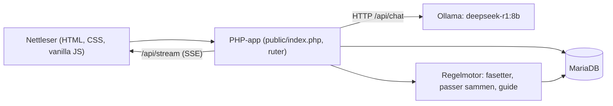

# Arkitektur

## Beslutninger (ADR i kortform)

| Nr | Beslutning | Begrunnelse |
|---|---|---|
| ADR-001 | Egen PHP 8.4 + MariaDB, uten rammeverk og byggesteg | Ligner Sør-Tre (WordPress og WooCommerce på MySQL), lett å forstå og forklare, ingen npm-bygg |
| ADR-002 | Kun lokal kjøring med Docker Compose | Offentlig kopi med Sør-Tre sine produkter og demo-anmeldelser kan villede kunder. Åpen redigering og opplasting inviterer misbruk |
| ADR-003 | Spesifikasjoner som rader (EAV), ikke kolonner | Nye spesifikasjonstyper krever ingen migrering |
| ADR-004 | Sanntid med hendelsestabell og Server-Sent Events i stedet for LISTEN/NOTIFY | MariaDB har ikke LISTEN/NOTIFY. Fungerer på alle MySQL-varianter uten utvidelser |
| ADR-005 | DeepSeek-R1 via Ollama på verten, med regelbasert reserve | Synlig resonnement (hvitboks), ingen data til eksterne KI-tjenester, demoen virker uten modell |
| ADR-006 | E-post skrives til en tabell og vises i en demo-innboks | Ingen e-post forlater maskinen. Ingen ekstra tjeneste |

## Komponenter

## Datamodell (hovedtabeller)

| Tabell | Innhold |
|---|---|
| `products` | id, sku, navn, slug, pris_ore, kort- og langbeskrivelse fra Sør-Tre, kildelenke |
| `categories`, `product_categories` | Sør-Tre sitt kategoritre |
| `product_images` | bilde, rekkefølge, type (sortre, kunde_ferdig_montert), opplastet_av |
| `spec_keys` | nøkkel, etikett, enhet, datatype, fasett (ja/nei). Ny spesifikasjonstype = ny rad |
| `spec_values` | produkt, nøkkel, verdi, versjon (verifisert eller apen), kilde (sortre, utledet, bruker, ansatt), evidens, revisjon |
| `spec_revisions` | Git-lignende endringssett: hvem, hva (JSON diff), kommentar, status (aktiv, flettet, avvist, tilbakestilt) |
| `warehouses`, `stock` | 12 varehus. Per produkt og varehus: på lager fysisk, nettlager, bestillingsvare med forventet dato |
| `users`, `roles` | bruker, verifisert-status beregnes: e-post bekreftet OG minst én betalt ordre |
| `orders`, `order_items` | Demo-kasse (Vipps og Klarna simulert) |
| `reviews` | Bare fra verifiserte kjøpere av akkurat produktet |
| `relations` | produkt A, produkt B, type (passer_sammen, alternativ), nivå (dokumentert, regelutledet, antatt), begrunnelse |
| `manuals` | monteringsveiledning per produkt eller produktgruppe: steg, bilder, PDF |
| `support_tickets`, `support_messages` | Eskalering fra chat til Support |
| `events` | Hendelseslogg for sanntid (id, kanal, payload JSON) |
| `mail_outbox` | Utgående e-post vist i demo-innboksen |
| `analytics_events` | Søk, nullresultat, guide, handlekurv, kjøp, eskalering. Brukes av KPI-dashboard |

## To-versjonssystemet

Hver spesifikasjon finnes i opptil to versjoner. Verifisert er Sør-Tre sine data, pluss det en ansatt har godkjent. Åpen er det verifiserte kjøpere har lagt til eller endret, som på Wikipedia. Produktsiden viser begge, side om side, med kilde på hver verdi. En redigering lager en `spec_revision` og oppdaterer den åpne versjonen umiddelbart. En ansatt ser endringen i køen og kan flette den inn i Verifisert, avvise den eller tilbakestille den. Utledede verdier (fra produkttekst) ligger i Åpen med kilde `utledet`, til en ansatt bekrefter dem.

## Sanntid uten LISTEN/NOTIFY

Når noe skjer (ny revisjon, svar i supportsak, lagerendring), skrives en rad til `events` i samme transaksjon som selve endringen. Endepunktet `/api/stream` holder en Server-Sent Events-tilkobling åpen. Det spør `events WHERE id > siste_id AND kanal IN (...)` hvert sekund og sender nye rader. Nettleserens EventSource kobler automatisk til igjen og sender `Last-Event-ID`, så ingen hendelser går tapt. Dette er et "transactional outbox"-mønster. Det gir samme effekt som LISTEN/NOTIFY for en demo, på hvilken som helst MySQL eller MariaDB.

Merk til rapporten: det var EAV-modellen (rader i stedet for kolonner) som gjør at nye beskrivelser ikke krever migrering. LISTEN/NOTIFY løser bare varslingen, ikke migreringsproblemet.

## Maskoten og KI-chatten

1. Kundens melding tolkes først deterministisk (søkeord, synonymer, bruksområder) og gir en liste kandidatprodukter fra databasen.
2. Kandidatene (ID, navn, pris, spesifikasjoner med kilde) og regler sendes til DeepSeek-R1 som data.
3. Svaret strømmes til nettleseren. `<think>`-delen vises i panelet "Slik tenkte maskoten (kan inneholde feil)".
4. Produktkort i svaret rendres fra databasen. ID-er som ikke var blant kandidatene forkastes.
5. "Snakk med et menneske" oppretter en supportsak. Support-rollen ser den live via SSE.
6. Er Ollama utilgjengelig, svarer regelmotoren med et synlig beslutningsspor (hvilke filtre og regler som ble brukt).

## Kjøring

| Miljø | Hvordan |
|---|---|
| Utvikling (skyserveren) | `PHP_CLI_SERVER_WORKERS=4 php -S 0.0.0.0:8080 -t public` mot lokal MariaDB. Flere arbeidere trengs fordi SSE holder en tilkobling åpen |
| Demo (egen PC) | `docker compose up` (php:8.4-apache og mariadb). Ollama kjører på verten. Appen når den via `http://host.docker.internal:11434` |

Modell på RTX 4050 (6 GB VRAM): `ollama pull deepseek-r1:8b` (cirka 5 GB). Er den for treg, bruk `deepseek-r1:7b`.
