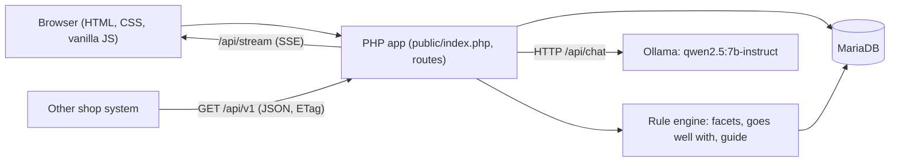

# Architecture

Diagrams of the system, a request, the chat, product data, login, live updates and security boundaries: `docs/architecture/diagrams.md`.

## Decisions (short ADRs)

| No. | Decision | Rationale |
|---|---|---|
| ADR-001 | Custom PHP 8.4 + MariaDB, no framework and no build step | Similar to Sør-Tre (WordPress and WooCommerce on MySQL), easy to understand and explain, no npm build |
| ADR-002 | Local only, with Docker Compose | A public copy with Sør-Tre's products and demo reviews could mislead customers. Open editing and uploads invite abuse |
| ADR-003 | Specifications as rows (EAV), not columns | New specification types require no migration |
| ADR-004 | Live updates with an event table and Server-Sent Events instead of LISTEN/NOTIFY | MariaDB has no LISTEN/NOTIFY. Works on every MySQL variant without extensions |
| ADR-005 | DeepSeek-R1 via Ollama on the host, with a rule-based fallback | Visible reasoning (white box), no data to external AI services, the demo works without a model |
| ADR-006 | Email is written to a table and shown in a demo inbox | No email leaves the machine. No extra service |
| ADR-007 | A versioned public REST API (`/api/v1`) instead of sharing the schema | Another shop system (for example WooCommerce, which uses the same product IDs) can reuse specifications, relations, reviews and the product assistant through a stable contract with its own field names. Reading is GET only; the one POST asks the assistant, which runs the chat's guardrails on the server so the local model is never exposed. Internal tables can change without breaking callers. Stateless, cacheable with ETags, described in OpenAPI 3.1 (`docs/api/openapi.json`) |

## Components

The Demo Hub (`/presentasjon`, staff roles only, `src/Presentation.php`) is an overview page over the same app. It reads the counts from the database on each request and adds no tables; its diagram lists the connections above with the data and mechanism of each (specs/033).

## Data model (main tables)

| Table | Contents |
|---|---|
| `products` | id, sku, name, slug, price in øre, short and long description from Sør-Tre, source link |
| `categories`, `product_categories` | Sør-Tre's category tree |
| `product_images` | image, order, type (sortre, customer photo of the finished result), uploaded by |
| `spec_keys` | key, label, unit, data type, facet (yes/no). New specification type = new row |
| `spec_values` | product, key, value, version (verified or open), source (sortre, utledet, bruker, ansatt), evidence, revision |
| `spec_revisions` | Git-like change sets: who, what (JSON diff), comment, status (active, merged, rejected, rolled back) |
| `warehouses`, `stock` | 12 stores. Per product and store: physical stock, online stock, backorder with expected date |
| `users`, `roles` | user, verified status is computed: email confirmed AND at least one paid order |
| `orders`, `order_items` | Demo checkout (Vipps and Klarna simulated) |
| `reviews` | Only from verified buyers of that exact product |
| `relations` | product A, product B, type (goes well with, alternative), level (documented, rule based, assumed), reason |
| `manuals` | assembly guide per product or product group: steps, images, PDF |
| `chat_conversations`, `chat_messages` | The chat history, owned by the server. Owner is a hash of a random token in the session. Expires 24 hours after the last message, at most 40 messages per conversation. `reviewed_at` marks a conversation staff have read in the Control Tower drill-down. `product_ids` on an answer lists the products it was about, for follow-up questions (feature 034) |
| `support_tickets`, `support_messages` | Escalation from the chat to Support. The chat log in the case is copied from `chat_messages`, and `conversation_id` links the conversation it came from |
| `improvement_tasks` | Control Tower tasks with explicit states (åpen, under behandling, klar for kontroll, fullført, avvist, arkivert), source, product, specification key, revision and `origin`, which stops a second active task for the same thing. Merging or rejecting a buyer change settles the linked tasks |
| `sim_clock` | The one clock of the transport simulation (feature 043): simulated seconds at an anchor, the anchor's real time, rate, pause and scenario (`ekte` or `storm`). It pauses itself when no trip is on the road |
| `shipment_plans` | One plan per demo trip: start time and the route points with the stored weather, road messages and ferry timetable they were planned with. Movement, waiting, ferries, the delay and the notifications are computed from it (`DemoSim`); `stocked` makes sure an arrival fills the shelf once |
| `supply_list` | The order list: products missing in the receiving store, marked in Innsikt (`valgt`), fetched by a vehicle (`bestilt`, with the shipment and source store) and received (`mottatt`) |
| `events` | Event log for live updates (id, channel, JSON payload) |
| `mail_outbox` | Outgoing email shown in the demo inbox |
| `audit_log` | Logins, lockouts, password resets, staff actions and backups for the admin page `/admin`. Stores a daily hash instead of the IP address |
| `analytics_events` | Searches, zero results, guide, cart, purchase, escalation. Used by the KPI dashboard |

## The two-version system

Every specification exists in up to two versions. Verified is Sør-Tre's data plus what staff have approved. Open is what verified buyers have added or changed, like on Wikipedia. The product page shows both side by side, with a source on every value. An edit creates a `spec_revision` and updates the open version immediately. Only the values the buyer changed are checked and saved; measured fields with a unit (`Extract::KEYS`, such as weight or length) must be numbers, while keys read from Sør-Tre's free-text tables (`x_*`) keep their own format, such as «4 x LED». Staff see the change in their queue and can merge it into Verified, reject it or roll it back. Derived values (from product text) sit in Open with the source `utledet` until staff confirm them.

## Live updates without LISTEN/NOTIFY

When something happens (new revision, staff decision, spec report, checkout, support case or message), a row is written to `events`. Buyer edits, staff merges and rejects, and checkout write it in the same transaction as the change; the others write it right after their own statement. The `/api/stream` endpoint keeps a Server-Sent Events connection open for 25 seconds. It queries `events WHERE id > last_id AND channel IN (...)` every 0.7 seconds and sends new rows. The browser's EventSource reconnects automatically and sends `Last-Event-ID`, so no events are lost. The chat panel and the Control Tower listen. Events on `product:{id}` and `stock` are written, but no page listens to them yet. This is a "transactional outbox" pattern. It has the same effect as LISTEN/NOTIFY for a demo, on any MySQL or MariaDB.

Note: it is the EAV model (rows instead of columns) that means new descriptions require no migration. LISTEN/NOTIFY only solves the notification, not the migration problem.

## The mascot and the AI chat

1. The browser sends only the new message and the page address. Earlier messages and their roles come from `chat_messages` (`src/ChatHistory.php`), so the browser cannot add answers in the mascot's name. A question and its answer are saved together after the answer is finished.
2. The customer's message is first interpreted deterministically by `src/ProductRetriever.php` (feature 034), which gives one ranked list of up to five products. Signals with fixed points in one `WEIGHTS` constant: exact SKU and model code (H5R, CS720), the whole product name, the products on the page, the products of the previous answer when the question refers back («de to», «begge», «den»), the store search (`Search::run`, unchanged: words, typos, synonyms, use cases), documented and rule-based relations for accessories the customer asks for, and the same category for «noe lignende». Words that only state intent («komplett», «sett», «sammen») are never searched for, weak word hits are dropped instead of filling the slots, and every product keeps the signals behind its score. Catalogue-wide questions (cheapest, best rated) still go to `CatalogIntent`. No model calls.
3. The candidates (ID, name, specifications with source, and references such as `[[pris:ID]]` instead of price and stock) and rules are sent to DeepSeek-R1 as data. The server fills in the references from the database while the answer streams (`src/ProductRef.php`).
4. The answer is streamed to the browser. The reasoning is shown in the panel «Sørens resonnement (generert, kan være feil)».
5. Product cards next to the answer are the same list the model got (`Catalog::cards`), never taken from the model's text. The list is stored on the answer (`chat_messages.product_ids`), so a follow-up means the same products. Only the latest answer in the owner's own, unexpired conversation is read back, and only IDs still in the catalogue. The public API uses the same retriever but keeps no conversation, so it has no product memory between questions; the product the endpoint names is always put first in its list (`PublicApi::grounding`, feature 038), so the model and the answer guard always have its facts. Stock in the facts is for a named store: the customer's choice, or the default store for API calls, which have no session.
6. Every answer sentence is checked against the database before it is sent (`src/AnswerGuard.php`, feature 035). An amount in kroner the model wrote itself must be the price of the product the sentence names, the total of the products it names, or an amount in the facts; otherwise it becomes that product's own price reference, or a pointer to the product card. A price reference next to another product's name is moved to the named product. A sentence that says products fit when the catalogue documents «passer ikke» between them is replaced by the documented fact. Products are identified by reference, own model code, or the words that set one name apart from the others in the facts, never by a name alone.
7. Totals are worked out by the server in øre: a total question gets a `[[sum:ID+ID]]` reference in the facts, a plain one («hva koster de to sammen?») is answered without the model, and an answer that leaves the total out gets it added. A product without a price, or not in the catalogue, means there is no total, never zero kroner.
8. Fit has a fixed order: «passer ikke» (documented) always wins, then «passer sammen» documented by Sør-Tre, then rule-based (shown as not confirmed). «Kjøpt sammen» is never a fit and is not in the facts as one. No relation means unknown.
9. A model code the customer names that is surely a product model and not in the catalogue (`ProductRetriever` returns it in `unknown`, feature 036) gets one sentence from the server: «Vi har dessverre ikke H9R Signature i sortimentet.» With no other products, the model is not asked; otherwise the sentence comes first and the facts tell the model not to describe or compare the missing model. Not found by search is not the same as not sold: only codes shaped like a model, not a standard or size, and not close to a code the catalogue has, count.
10. Factual questions are answered by the server, not the model (`src/FactAnswer.php`, feature 039): price, cheaper or dearer, stock for a store, a named specification, differences on verified specifications, item number and brand, whether one product fits another, and catalogue rankings (`CatalogIntent`, which now limits the list to the product type named, so «billigste hodelykt» never ranks hooks or accessories made for headlamps). The answer is built from the database with the same references and the same fit order as item 8; a specification has its level (Sør-Tre, staff, derived, buyer, Sør-Tre's own product text) or is said to be unknown. The model is asked only when the question wants advice or an explanation («hvorfor», «hvordan», «anbefaler»), or when no product can be identified. The public API reply then has `model.used = false` and a notice; its fields are unchanged.
11. Every chat and API question is traced under one correlation ID (`src/Trace.php`, `data/traces/YYYY-MM-DD.jsonl`, seven days, local only, off with `SOREN_TRACE=0`): the route and timings, the facts and guard context, the exact request body sent to Ollama and the thinking and text that came back, each sentence the guard changed, and the final answer. The API returns the ID in `X-Trace-Id`. No session, cookie, IP address or account is written.
12. Model answers are validated before the customer sees them (`AnswerGuard::violation`, feature 040). For an advice question the server first writes the factual part itself (`FactAnswer::basis`, for example the charging method and the documented chargers and misfits), shows it, and gives it to the model as a fixed answer to explain. Each answer sentence is then checked: no product or model code outside the products in the facts, no product of another type than the one a recommendation asked for, no charging method, IP rating or number with a unit (weight, lumen, mAh, hours, volt) that the product's evidence (name, Sør-Tre's text, verified values) lacks, no unfilled note or prompt label, and no fit claim against a documented relation, also through «den» or «denne kabelen» about the product named before. The first invalid sentence stops the model; the chat gets `answer_reset` and the server's answer instead, and the API sets `notice`. The public API counts every question against `API_QUESTION_LIMIT` (60 per 10 minutes) and only questions that reach the model against `API_ASK_LIMIT` (10). Since feature 041 the model writes no customer text, so this validation is no longer on a customer path.
13. The model only reads the question (feature 041). `Understand::read` asks Ollama (`OLLAMA_MODEL`, a small non-reasoning model, `format` with a JSON schema whose property keys come from `spec_keys`, `think` and `stream` off, 10 s) for intent, product type, requirements, budget and missing information. `Understand::validate` keeps only what the customer's own message supports: a product type written in the message that the catalogue has, a requirement whose number and direction («minst», «under») are in the text, a budget in the text, a cart or order intent with cart or order words; two readings of one property are both dropped. Without the model, or past the API's model allowance, `Understand::rules` reads the same fields. `ShopAnswer` then owns everything the customer sees: products of the named type, filtered on budget and verified values, ranked by stock in the store, web stock and price, written from templates with references for price and stock; the server's factual answer for a product in focus; the cart from `cart_items`; the customer's orders; a clarification when nothing names a product. Small talk gets a fixed reply too; the model writes nothing the customer sees. The reading uses the current message only, and a number for a property with a unit counts only next to the unit.
14. Fixed replies before everything else (feature 042, `QuickReply`): the whole message, normalized, is matched against a short list of greetings, thanks, identity and help questions and filler, and questions about the weather or ferries without a product type. A match is answered by PHP without the retriever or Ollama (30.7 ms p50 through the chat route, feature 042 verification). Customers are not shown the staff-only Control Tower; staff get its link.
6. "Talk to a human" creates a support case with the log from the server. The Support role sees it live via SSE.
7. If Ollama is unavailable or too slow, a rule-based answer is used instead: the catalog overview's own answer, or what goes well with the first product (`Chat::fallback`), with a note that the language model is not answering.

## Running

| Environment | How |
|---|---|
| Development (cloud server) | `PHP_CLI_SERVER_WORKERS=4 php -S 0.0.0.0:8080 -t public` against a local MariaDB. Several workers are needed because SSE keeps a connection open |
| Demo (own PC) | `docker compose up` (php:8.4-apache and mariadb). Ollama runs on the host. The app reaches it via `http://host.docker.internal:11434` |
