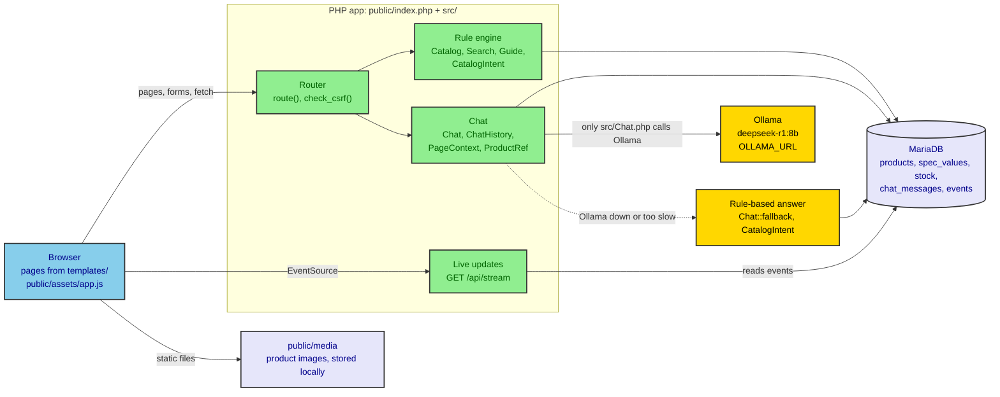
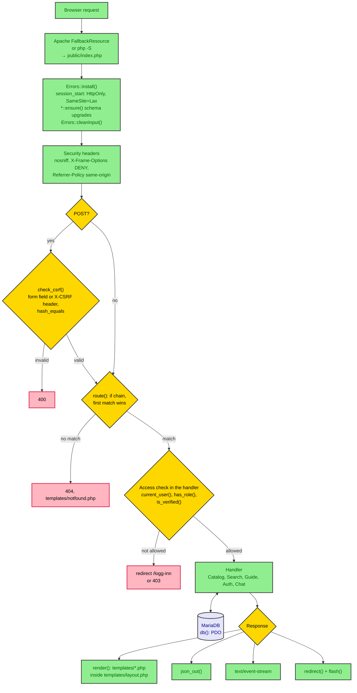
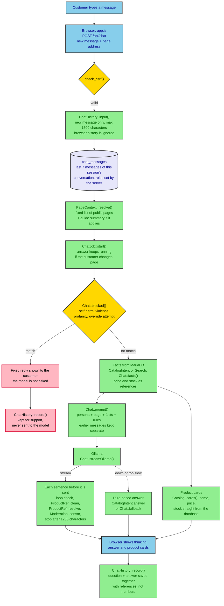
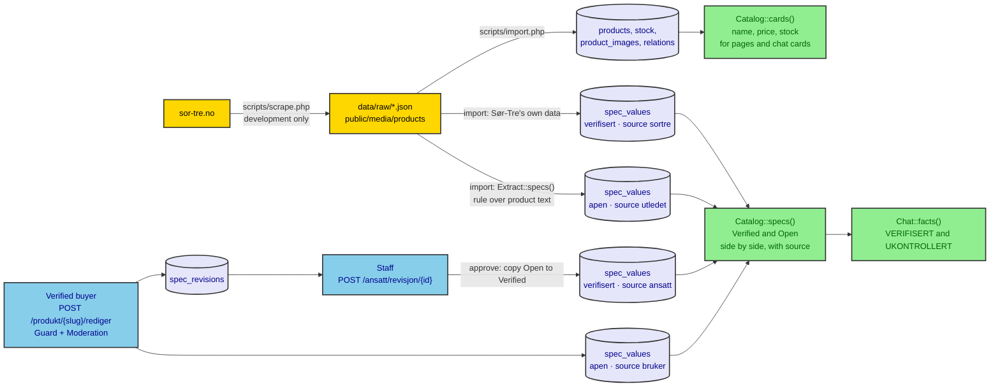
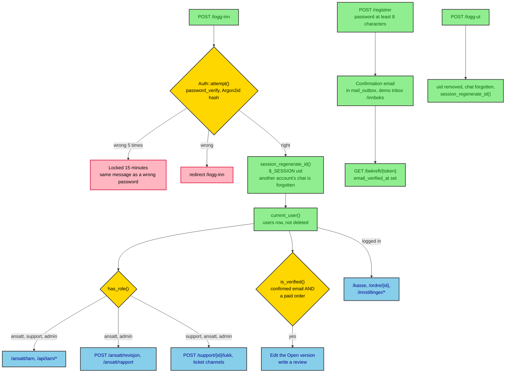
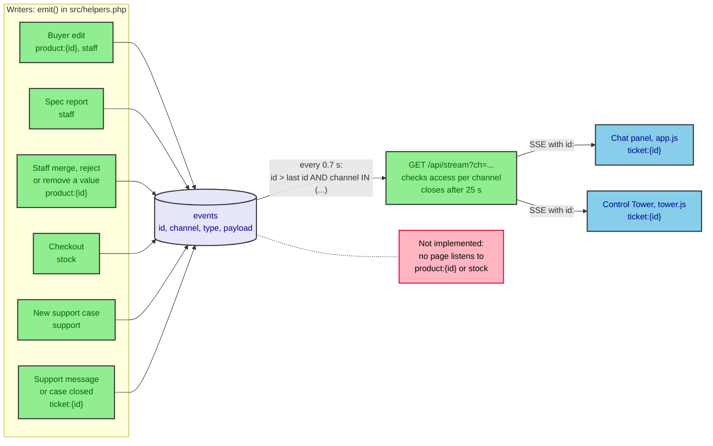
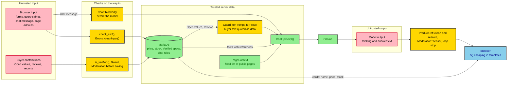

# Architecture diagrams

Seven Mermaid flowcharts of how Sørpedia works today. Every arrow was checked against the source. Dotted arrows are fallbacks. Boxes marked **Not implemented** describe something the code does not do yet; nothing else in these diagrams is planned work.

Component names are the same in every diagram: **Browser**, **PHP app** (`public/index.php` and `src/`), **MariaDB**, **Ollama**, **Rule-based answer**.

Update a diagram in the same change that changes the code it shows.

## 1. System architecture

The browser talks only to the PHP app; it never reaches MariaDB or Ollama directly. Search, filters, the product guide and "goes well with" are rules over the database and never call the language model (enforced by `.claude/hooks/check_code.py`). Only `src/Chat.php` talks to Ollama, the one external service at runtime. If Ollama is down or too slow, the chat answers from the catalog with rules instead. In Docker (`docker-compose.yml`) the app runs on `php:8.4-apache`, the database on `mariadb:10.11`, and Ollama on the host machine.

Sources: `public/index.php`, `src/Chat.php`, `src/Catalog.php`, `docker-compose.yml`.

## 2. HTTP request lifecycle

Every request goes through one front controller. CSRF is checked once, for every POST, before any route runs. There is no framework or middleware: each route is an `if (route(...))` block, and each handler checks its own access rules. PHP errors are logged with a reference, never shown to the customer.

Sources: `public/index.php` (top of file and every `route(` block), `src/helpers.php` (`check_csrf`, `current_user`, `has_role`, `is_verified`, `render`, `json_out`), `src/Errors.php`.

## 3. Søren chat lifecycle

The browser sends only the new message and the address of the page it is on. The server adds the earlier messages from its own table and decides what Søren may see: only public product pages, never accounts, carts or orders. Messages about self harm, violence, profanity or attempts to override him get a fixed reply without asking the model. The model never gets exact prices or stock counts. It gets references such as `[[pris:298381]]`, and the server fills in the current database value while the answer streams, after removing references to products that were not in the facts. Product cards are built from the database by search, never from the model's text. The question and answer are saved together only once the answer is finished.

**Not implemented:** an amount the model writes in its own words, instead of a reference, is not checked at runtime. `evals/soren.php` flags it in the evaluation.

Sources: `public/index.php` (route `POST /api/chat`), `src/ChatHistory.php`, `src/PageContext.php`, `src/ChatJob.php`, `src/Chat.php` (`blocked`, `facts`, `prompt`, `answer`, `streamOllama`, `fallback`), `src/ProductRef.php`, `src/CatalogIntent.php`, `public/assets/app.js`.

## 4. Product data flow

The database is the only source for product name, ID, price and stock. Every specification is a row in `spec_values` with a version (`verifisert` or `apen`) and a source: `sortre` from Sør-Tre, `utledet` derived by a rule from the product text, `bruker` from a verified buyer, `ansatt` approved by staff. Derived and buyer values are always in the Open version; only Sør-Tre's data and staff approvals are Verified. A new kind of specification is a new row in `spec_keys`, never a new column. Price and stock on every card come from `Catalog::cards()`.

Sources: `scripts/scrape.php`, `scripts/import.php`, `src/Extract.php`, `public/index.php` (routes `/produkt/{slug}/rediger` and `/ansatt/revisjon/{id}`), `src/Catalog.php`, `db/schema.sql`.

## 5. Authentication and authorization

Login is a session cookie, renewed with `session_regenerate_id()` at login, logout, password change and account deletion. The four roles are `bruker`, `ansatt`, `support` and `admin`, stored on the user row. "Verified" is not a role: it is computed on each request as a confirmed email plus at least one paid order. The Control Tower redirects to login when access is missing; it is the only staff page. The staff POST actions `/ansatt/revisjon/{id}` and `/ansatt/rapport/{id}` answer 403; closing a support case without the role does nothing and redirects. The demo users are listed in the README.

Sources: `src/Auth.php`, `src/helpers.php` (`current_user`, `has_role`, `is_verified`), `public/index.php` (routes `/logg-inn`, `/logg-ut`, `/registrer`, `/bekreft/{token}`, `/ansatt/tarn`, `/ansatt/*`, `/support/{id}/lukk`, `settings_user()`).

## 6. Live updates

A change writes a row to `events`. Buyer edits, staff merges and rejects, and checkout do it inside the same transaction as the change. The other writers (spec reports, removing a reported value, support cases and messages) write it right after their own statement, without a transaction. `/api/stream` reads new rows for the requested channels every 0.7 seconds and sends them as Server-Sent Events. It closes after 25 seconds and the browser reconnects with `Last-Event-ID`, so no event is lost. Ticket channels are open to the session that created the case and to support staff; `support` and `staff` only to staff.

**Not implemented:** events on `product:{id}` and `stock` are written, but no page subscribes to them, so product pages and stock do not update live.

Sources: `src/helpers.php` (`emit`), `public/index.php` (route `GET /api/stream` and every `emit(` call), `public/assets/app.js`, `public/assets/tower.js`.

## 7. Security boundaries

Three kinds of text are never trusted: what the browser sends, what buyers write, and what the model generates. Browser input passes the CSRF check and is escaped in templates. Buyer text is checked before it is saved, kept in the Open version, and quoted as data when it reaches the prompt. Chat messages pass the fixed safety checks first. Model output is checked sentence by sentence before the customer sees it. Price, stock and product identity on the cards go straight from the database to the browser and never pass through the model. Earlier chat messages come from the server, so the browser cannot forge Søren's side of the conversation.

**Not implemented:** amounts the model writes in its own words are not checked at runtime, and the pre-model checks are regex patterns, so rephrased messages can get through.

Sources: `src/helpers.php`, `src/Guard.php`, `src/Moderation.php`, `src/Chat.php`, `src/ProductRef.php`, `src/PageContext.php`, `src/ChatHistory.php`.
