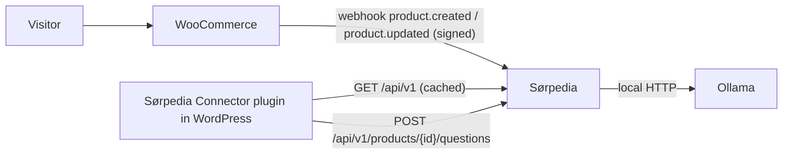

# Running Sørpedia next to a WooCommerce shop

Sørpedia does not replace the web shop. WooCommerce keeps checkout, payment, orders, stock, customers and its own product pages. Sørpedia adds the knowledge layer on top: specifications with source and level, related products with level and reason, reviews from verified buyers, and a product assistant that runs on a local language model. The two share the shop's product IDs, so no mapping table is needed.

| Stays in WooCommerce | Added by Sørpedia |
|---|---|
| Product master data: ID, name, SKU, price | Specifications with source (`store`, `derived`, `buyer`, `staff`) and level |
| Checkout and payment providers | "Goes well with" with level (documented, rule based, assumed) |
| Orders, stock, customers | The product assistant, with the chat's guardrails |
| Product pages and theme | Search that tolerates typos and use cases |
| | Control Tower for staff: approvals, searches without results, customer service |

## How the parts connect

The visitor only talks to the shop. The shop server talks to Sørpedia, and only Sørpedia talks to Ollama, so the language model is never exposed to the internet and every answer passes the same guardrails as in the Sørpedia chat (fixed answers for blocked input, names, prices and stock from the database).

## Setup

1. Deploy Sørpedia with `docker compose up -d` on a server the shop can reach. Set `WC_WEBHOOK_SECRET` (a long random string) `API_QUESTION_LIMIT` (questions per 10 minutes from one address) and `API_ASK_LIMIT` (of those, the ones the language model reads; the rest are read by rules). The shop server is one address for all its visitors.
2. Run Ollama on the same machine or network and set `OLLAMA_URL` and `OLLAMA_MODEL`. A GPU makes answers fast; on CPU an 8B model answers in tens of seconds. Ollama needs no public port.
3. Load the catalogue once with `php scripts/scrape.php` and `php scripts/import.php`. The scraper reads the shop's public WooCommerce Store API (`/wp-json/wc/store/v1/products`). A typical WooCommerce `robots.txt` only disallows cart, nonce and customizer parameters (`add-to-cart`, `remove_item`, `_wpnonce`, `customize_changeset_uuid`, `customize_autosaved`), none of which the scraper uses. It sends one request at a time.
4. In WooCommerce, Settings > Advanced > Webhooks, add two webhooks with API version 3, topics `Product created` and `Product updated`, delivery URL `https://<sorpedia>/api/integrations/woocommerce/webhook` and the same secret. Each delivery is checked against the signature header (base64 HMAC-SHA256 of the body), applied once per delivery ID, and updates ID, name, SKU, price and the shop's own specifications. Values from buyers and staff are kept.
5. Install the plugin in `integrations/woocommerce/sorpedia-connector` and enter the API address under Settings > Sørpedia.

## What the shop gets

1. Product pages show "Fakta og kilder", "Passer sammen med" and "Spør Søren" from the API, cached for five minutes.
2. Any other system can use the same API: documentation and a live console at `/api/docs`, the contract in `docs/api/openapi.json`.
3. Staff keep using the Control Tower in Sørpedia (`/ansatt/tarn`) for approvals and for searches that found nothing.

## Limits

1. Images are not fetched by the webhook; run the import again to fetch new product images.
2. Relations between products are built by the import; a new product gets them on the next import run.
3. Reviews in Sørpedia come from its own verified buyers. WooCommerce's own reviews are not synced.
4. Orders are not synced, so "bought together" relations and verified buyer status come from Sørpedia's own demo orders.
