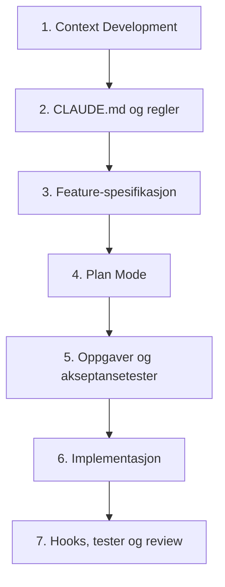

# Arbeidsprosess (fra prototype-veikart.docx, appendiks B)

Kilde: «Prototyping-fasen, et veikart», NFG/UiA 2026-08-07, appendiks B «Claude Code, tilsvarende prosess». Bare det som gjelder Sørpedia er tatt med.

## Flyten

## Hvor ting ligger i dette repoet

| Formål | Fil |
|---|---|
| Permanent prosjektkontekst | `CLAUDE.md` |
| Prosjektprinsipper (constitution) | `docs/governance/constitution.md` |
| Kontekst (virksomhet, taksonomi, risiko) | `docs/context/` |
| Arkitektur og datamodell | `docs/architecture/architecture.md` |
| Feature-backlog | `specs/README.md` |
| Feature-spesifikasjon | `specs/NNN-navn/spec.md` |
| Verifikasjon | `specs/NNN-navn/verification.md` |
| Automatiske kvalitetsporter | `.claude/settings.json` (hooks) |

## Stegene kort

1. **Context Development.** Skriv ned brukere, problemer, datakilder og risiko i `docs/context/` før arkitektur. Skill mellom dokumentert, regelutledet og antatt.
2. **CLAUDE.md og constitution.** CLAUDE.md har de faste reglene og peker videre. Alle planer og implementasjoner skal følge `docs/governance/constitution.md`. Stopp og meld fra ved konflikt mellom spec og constitution.
3. **Spesifikasjon.** `spec.md` beskriver hva og hvorfor, ikke teknologi: mål og avgrensning, aktører og brukerhistorier, hovedflyt og alternative flyter, funksjonelle og ikke-funksjonelle krav, forretningsregler, akseptansekriterier, målbare suksesskriterier og hva som er utenfor scope. Finn uklare formuleringer og avklar dem før den er ferdig.
4. **Plan Mode.** Når spec er godkjent: undersøk koden og lag en teknisk plan (komponenter, dataflyt, datamodell, bruk av språkmodell, feilhåndtering og eskalering, personvern, teststrategi, berørte filer, risiko). Ikke implementer før planen er godkjent. Planen lagres som fil, ikke bare i samtalen.
5. **Oppgaver.** Bryt planen ned i små, verifiserbare oppgaver med krav som dekkes, berørte filer, tester og Definition of Done.
6. **Implementasjon.** Én oppgave om gangen. Bekreft hvilke krav oppgaven dekker, implementer kode og tester, kjør kontrollene og sammenhold med Definition of Done. Ikke start neste oppgave.
7. **Hooks, tester og review.** CLAUDE.md er instruks, ikke håndheving. Kritiske regler skal ligge i kode, tester og hooks.

## Hooks i dette repoet

`.claude/settings.json` kjører `php -l` på hver PHP-fil Claude skriver eller endrer. Ved syntaksfeil får Claude feilmeldingen tilbake og må rette den før arbeidet fortsetter. Hooken trenger `php` og `jq` på maskinen der Claude Code kjører.

Aktuelle kontroller nevnt i veikartet som kan legges til senere: tester før oppgaven avsluttes, at produktnummer ikke hardkodes, og at regelmotoren for «passer sammen» ikke kaller språkmodellen.
