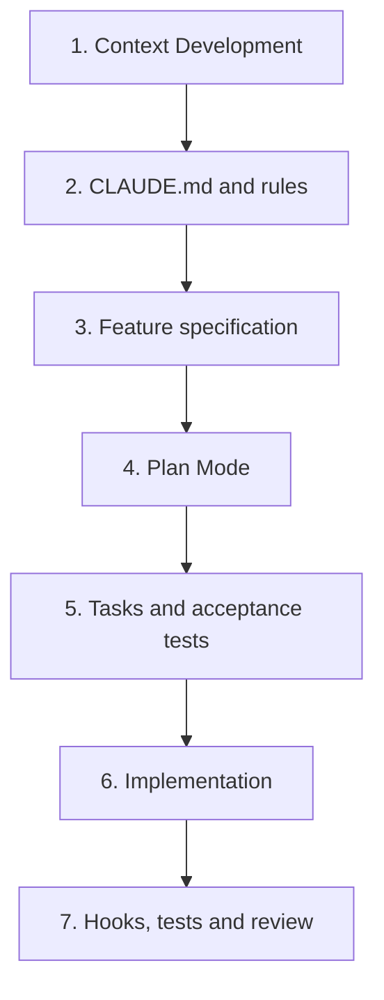

# Work process (from prototype-veikart.docx, appendix B)

Source: "Prototyping-fasen, et veikart", NFG/UiA 2026-08-07, appendix B "Claude Code, tilsvarende prosess". Only what applies to Sørpedia is included.

## The flow

## Where things are in this repo

| Purpose | File |
|---|---|
| Permanent project context | `CLAUDE.md` |
| Project principles (constitution) | `docs/governance/constitution.md` |
| Context (business, taxonomy, risk) | `docs/context/` |
| Architecture and data model | `docs/architecture/architecture.md` |
| Feature backlog | `specs/README.md` |
| Feature specification | `specs/NNN-name/spec.md` |
| Verification | `specs/NNN-name/verification.md` |
| Automatic quality gates | `.claude/settings.json` (hooks) |

## The steps in short

1. **Context Development.** Write down users, problems, data sources and risks in `docs/context/` before the architecture. Distinguish between documented, rule based and assumed.
2. **CLAUDE.md and constitution.** CLAUDE.md holds the fixed rules and points onward. All plans and implementations must follow `docs/governance/constitution.md`. Stop and report any conflict between a spec and the constitution.
3. **Specification.** `spec.md` describes what and why, not technology: goals and scope, actors and user stories, main and alternative flows, functional and non-functional requirements, business rules, acceptance criteria, measurable success criteria and what is out of scope. Find unclear wording and resolve it before the spec is done.
4. **Plan Mode.** Once the spec is approved: study the code and make a technical plan (components, data flow, data model, use of the language model, error handling and escalation, privacy, test strategy, affected files, risks). Don't implement before the plan is approved. The plan is saved as a file, not only in the conversation.
5. **Tasks.** Break the plan into small, verifiable tasks with the requirements covered, affected files, tests and a Definition of Done.
6. **Implementation.** One task at a time. Confirm which requirements the task covers, implement the code and tests, run the checks and compare with the Definition of Done. Don't start the next task.
7. **Hooks, tests and review.** CLAUDE.md is instruction, not enforcement. Critical rules belong in code, tests and hooks.

## Hooks in this repo

`.claude/settings.json` runs `php -l` on every PHP file Claude writes or edits. On a syntax error, Claude gets the error message back and has to fix it before continuing. The hook needs `php` and `jq` on the machine running Claude Code.

Checks mentioned in the roadmap that could be added later: tests before a task is closed, that product numbers are not hardcoded, and that the rule engine for "goes well with" never calls the language model.
