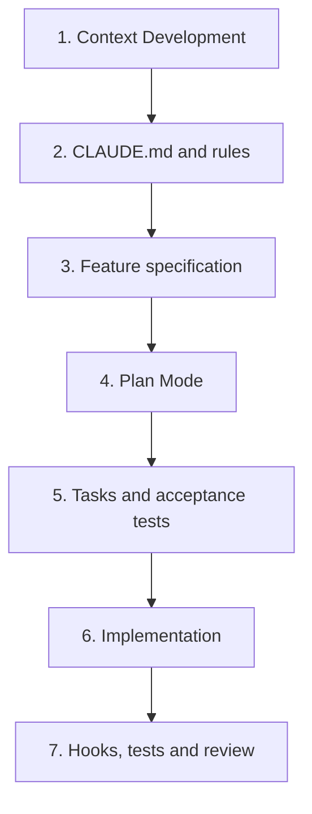

# Work process

## The flow

## Where things are in this repo

| Purpose | File |
|---|---|
| Permanent project context | `CLAUDE.md` |
| Project principles (constitution) | `docs/governance/constitution.md` |
| Context (business, taxonomy, risk) | `docs/context/` |
| Architecture and data model | `docs/architecture/architecture.md` |
| Feature backlog | `specs/README.md` |
| Feature specification | `specs/NNN-name/spec.md` |
| Verification | `specs/NNN-name/verification.md` |
| Automatic quality gates | `.claude/settings.json` (hooks) |

## The steps in short

1. **Context Development.** Write down users, problems, data sources and risks in `docs/context/` before the architecture. Distinguish between documented, rule based and assumed.
2. **CLAUDE.md and constitution.** CLAUDE.md holds the fixed rules and points onward. All plans and implementations must follow `docs/governance/constitution.md`. Stop and report any conflict between a spec and the constitution.
3. **Specification.** `spec.md` describes what and why, not technology: goals and scope, actors and user stories, main and alternative flows, functional and non-functional requirements, business rules, acceptance criteria, measurable success criteria and what is out of scope. Find unclear wording and resolve it before the spec is done.
4. **Plan Mode.** Once the spec is approved: study the code and make a technical plan (components, data flow, data model, use of the language model, error handling and escalation, privacy, test strategy, affected files, risks). Don't implement before the plan is approved. The plan is saved as a file, not only in the conversation.
5. **Tasks.** Break the plan into small, verifiable tasks with the requirements covered, affected files, tests and a Definition of Done.
6. **Implementation.** One task at a time. Confirm which requirements the task covers, implement the code and tests, run the checks and compare with the Definition of Done. Don't start the next task.
7. **Hooks, tests and review.** CLAUDE.md is instruction, not enforcement. Critical rules belong in code, tests and hooks.

## Hooks in this repo

`.claude/settings.json` runs these scripts from `.claude/hooks/`. They need `python3`, `php` and `git` on the machine running Claude Code. Personal working preferences go in each developer's own `~/.claude/settings.json`, not in the repo. Details, and what each hook does not stop, are in `docs/process/guardrails-and-hooks.md`.

| Hook | When | What it does |
|---|---|---|
| `.claude/hooks/delete_guard.py` | before every shell command | A command that deletes one file asks the user "Delete X?". A command that deletes several files at once is refused |
| `.claude/hooks/after_edit.py` | after Claude writes or edits a file | `php -l` on PHP files, `.claude/hooks/check_code.py` on code files, `.claude/hooks/check_docs.py` on Markdown files. A failure goes back to Claude, which has to fix it |
| `.claude/hooks/finish_gate.py` | before Claude's reply ends | `php -l` on every changed PHP file, `.claude/hooks/check_code.py`, `.claude/hooks/check_docs.py`, `tests/run.php`, `evals/run.php`, and PHPStan when a PHP file changed. Failures go back to Claude, once per session for the same findings |

The rest is checked by code, not by more instructions: a hook that adds text for Claude to follow can be misread or ignored, a test cannot.

`.claude/hooks/check_code.py` checks the code against the rules in `CLAUDE.md` and the constitution, and the quality gates in `docs/process/guardrails-and-hooks.md`:

| Check | Rule |
|---|---|
| No product ID or product slug from `data/raw/products.json` written into runtime code | CLAUDE.md rule 1, gate 4: product numbers are not hardcoded |
| `src/Catalog.php`, `src/CatalogIntent.php`, `src/Guide.php`, `src/Search.php`, `src/Extract.php` and `scripts/import.php` never call the language model, and only `src/Chat.php` talks to Ollama | Gate 5: the compatibility module never calls the language model |
| No external URL loaded or fetched by runtime code | CLAUDE.md rule 8 |
| No new column on `products` or the spec tables | CLAUDE.md rule 4, constitution 8 |
| No em or en dash in UI text | CLAUDE.md rule 6 |
| No trailing whitespace, CRLF or tab indentation, a final newline, `declare(strict_types=1)` in `src/`, `tests/` and `evals/` | Gate 1: formatting |
| The guardrails are still in the code: `Chat::blocked()` on every new chat message (crisis, violence, profanity and override checks before the model), server-owned chat history, product references checked while streaming, user text wrapped as data with `Guard::forPrompt`, `is_verified()`, the CSRF check, the login lockout | Constitution 9, `docs/context/risks-and-guardrails.md` |

`.claude/hooks/check_docs.py` compares the docs with the code and data: product, store, theme and assembly guide counts, test users and roles, settings defaults, lockout, password and upload limits, guide and compare limits, that every file path and route named in the docs exists, and approximations.

`tests/run.php` first loads every class in `src/` (PHP checks signatures and declarations when a class loads), then runs `tests/*Test.php`: guardrails (`Guard`, `Chat::crisis`, `Chat::violence`, `Moderation`), verified users, open redirects and escaping, login lockout, and the data rules (price from the database, source and level on specifications, level and reason on "goes well with", specifications as rows). Since feature 015 also the chat history (ownership, forged messages, order, expiry), product references (no prices or stock counts reach the model) and page context. Tests that write run inside a transaction that is rolled back, or delete their own rows.

`evals/golden.json` is the golden dataset, from the acceptance criteria in `specs/README.md` and the relations Sør-Tre documents. `evals/run.php` checks the catalog counts, local images, search cases, the guide's suggestion limit and every documented "goes well with" and "does not fit" pair. `evals/soren.json` holds the mascot's conversation cases: `evals/run.php` checks which ones get a fixed safety reply, and `evals/soren.php` runs the rest against Ollama and writes the answers out for review.

All run by hand: `python3 .claude/hooks/check_code.py`, `python3 .claude/hooks/check_docs.py`, `php tests/run.php`, `php evals/run.php`, the model cases in `evals/soren.php`, and PHPStan with `php -d memory_limit=1G tools/phpstan.phar analyse` (install with `sh scripts/tools.sh`).
